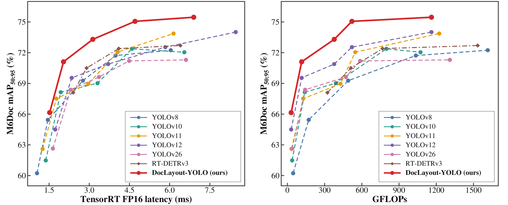

<div align="center">
<h1>DocLayout-YOLO: Axis-Attentive Document Layout Detector with Mesh-Guided Synthetic Pretraining</h1>
<a href="https://arxiv.org/abs/2610.28171"></a>
<a href="https://www.modelscope.cn/studios/JulioZhao97/DocLayout-YOLO-demo"></a>

</div>

<div align="center">

</div>

<details>
  <summary>
  <font size="+1">Abstract</font>
  </summary>

Accurate and efficient document layout analysis is critical for modern document parsing systems. However, although the YOLO framework represents a leading paradigm for real-time detectors, its adaptation to heterogeneous documents remains underexplored. To address this gap, we propose DocLayout-YOLO, a document-specialized real-time detector that integrates diverse synthetic document pretraining and page-axis context modeling. From the data perspective, we introduce MeshLayout-1M, a synthetic pretraining corpus generated by the proposed Mesh-candidate BestFit algorithm, which provides large-scale and diverse document layouts for pretraining and improves adaptation to heterogeneous document scenarios. From the model perspective, we propose Page-Axis Layout Attention (PALA), which captures long-range dependencies along the horizontal and vertical page axes while remaining computationally efficient. Extensive experiments demonstrate that DocLayout-YOLO achieves state-of-the-art performance on four heterogeneous document-layout benchmarks, obtaining 72.4/75.5/96.0/73.1 mAP<sub>50-95</sub> on D4LA, M6Doc, HJDataset, and PRIMA-LAD, respectively. Compared with existing real-time detectors, DocLayout-YOLO establishes a superior accuracy-efficiency trade-off in document layout analysis.

</details>

## Installation

```bash
conda create -n doclayout_yolo python=3.10
conda activate doclayout_yolo
python -m pip install -r requirements.txt
python -m pip install -e .
# Recommended for compatible NVIDIA GPUs:
python -m pip install flash-attn==2.7.3 --no-build-isolation
```

FlashAttention is recommended for compatible NVIDIA GPUs, but it is optional — the package also runs without it. If you choose not to install FlashAttention, simply skip the command above.

## General Layout Analysis

We also provide a **general-purpose layout detection model** trained on large-scale real-world documents, with **22 fine-grained layout categories**, making it a practical drop-in front-end for document parsing pipelines.

**Weights:** [DocLayout-YOLO-universal.pt](https://huggingface.co/juliozhao/DocLayout-YOLO/resolve/main/universal/DocLayout-YOLO-universal.pt)

Quick inference (after completing [Installation](#installation)):

```python
from ultralytics import YOLO

model = YOLO("DocLayout-YOLO-universal.pt")  # download from the link above
results = model.predict("page.png", imgsz=1024, conf=0.25, iou=0.5, verbose=False)

# save the visualization
results[0].save(filename="result.jpg")

# inspect detected boxes
for box in results[0].boxes:
    print(results[0].names[int(box.cls)], float(box.conf), box.xyxy[0].tolist())
```

Or try it online without any setup: [Online Demo (ModelScope)](https://www.modelscope.cn/studios/JulioZhao97/DocLayout-YOLO-demo).


## Main Results

| Model | size<br><sup>(pixels) | D4LA | M6Doc | HJDataset | PRIMA-LAD | Speed (ms)<br><sup>H200 TensorRT10 FP16 | params<br><sup>(M) | FLOPs<br><sup>(G) |
| :-- | :-: | :-: | :-: | :-: | :-: | :-: | :-: | :-: |
| n | 1600 | [67.2](https://huggingface.co/juliozhao/DocLayout-YOLO/resolve/main/downstream/D4LA/n_DocLayout-YOLO.pt) | [66.2](https://huggingface.co/juliozhao/DocLayout-YOLO/resolve/main/downstream/M6Doc/n_DocLayout-YOLO.pt) | [93.6](https://huggingface.co/juliozhao/DocLayout-YOLO/resolve/main/downstream/HJDataset/n_DocLayout-YOLO.pt) | [67.7](https://huggingface.co/juliozhao/DocLayout-YOLO/resolve/main/downstream/PRIMA-LAD/n_DocLayout-YOLO.pt) | 1.5 | 2.2 | 30.2 |
| s | 1600 | [70.6](https://huggingface.co/juliozhao/DocLayout-YOLO/resolve/main/downstream/D4LA/s_DocLayout-YOLO.pt) | [71.1](https://huggingface.co/juliozhao/DocLayout-YOLO/resolve/main/downstream/M6Doc/s_DocLayout-YOLO.pt) | [94.8](https://huggingface.co/juliozhao/DocLayout-YOLO/resolve/main/downstream/HJDataset/s_DocLayout-YOLO.pt) | [70.3](https://huggingface.co/juliozhao/DocLayout-YOLO/resolve/main/downstream/PRIMA-LAD/s_DocLayout-YOLO.pt) | 2.0 | 8.8 | 114.8 |
| m | 1600 | [70.7](https://huggingface.co/juliozhao/DocLayout-YOLO/resolve/main/downstream/D4LA/m_DocLayout-YOLO.pt) | [73.3](https://huggingface.co/juliozhao/DocLayout-YOLO/resolve/main/downstream/M6Doc/m_DocLayout-YOLO.pt) | [95.3](https://huggingface.co/juliozhao/DocLayout-YOLO/resolve/main/downstream/HJDataset/m_DocLayout-YOLO.pt) | [71.3](https://huggingface.co/juliozhao/DocLayout-YOLO/resolve/main/downstream/PRIMA-LAD/m_DocLayout-YOLO.pt) | 2.8 | 23.7 | 189.8 |
| l | 1600 | [72.4](https://huggingface.co/juliozhao/DocLayout-YOLO/resolve/main/downstream/D4LA/l_DocLayout-YOLO.pt) | [75.1](https://huggingface.co/juliozhao/DocLayout-YOLO/resolve/main/downstream/M6Doc/l_DocLayout-YOLO.pt) | [95.7](https://huggingface.co/juliozhao/DocLayout-YOLO/resolve/main/downstream/HJDataset/l_DocLayout-YOLO.pt) | [73.4](https://huggingface.co/juliozhao/DocLayout-YOLO/resolve/main/downstream/PRIMA-LAD/l_DocLayout-YOLO.pt) | 4.7 | 26.5 | 519.9 |
| x | 1600 | [72.4](https://huggingface.co/juliozhao/DocLayout-YOLO/resolve/main/downstream/D4LA/x_DocLayout-YOLO.pt) | [75.5](https://huggingface.co/juliozhao/DocLayout-YOLO/resolve/main/downstream/M6Doc/x_DocLayout-YOLO.pt) | [96.0](https://huggingface.co/juliozhao/DocLayout-YOLO/resolve/main/downstream/HJDataset/x_DocLayout-YOLO.pt) | [73.1](https://huggingface.co/juliozhao/DocLayout-YOLO/resolve/main/downstream/PRIMA-LAD/x_DocLayout-YOLO.pt) | 6.9 | 59.4 | 1161.1 |

## Dataset Preparation

We provide four downstream datasets (each is a YOLO-layout dataset directory: `images/`, `labels/`, and split lists):

| dataset | repository |
|:--|:--|
| D4LA | [juliozhao/D4LA](https://huggingface.co/datasets/juliozhao/D4LA) |
| M6Doc | [juliozhao/M6Doc](https://huggingface.co/datasets/juliozhao/M6Doc) |
| HJDataset | [juliozhao/HJDataset](https://huggingface.co/datasets/juliozhao/HJDataset) |
| PRIMA-LAD | [juliozhao/PRIMA-LAD](https://huggingface.co/datasets/juliozhao/PRIMA-LAD) |

Download them and place them under `datasets/` in the project root, keeping the exact folder names:

```text
datasets/
├── D4LA/
├── m6doc/
├── HJDataset/
└── prima-lad/
```


## Validation

```bash
python val.py \
  --data m6doc \
  --model /path/to/checkpoints/downstream/M6Doc/m_DocLayout-YOLO.pt \
  --project /path/to/output
```

`--data` accepts one of the dataset aliases `d4la` | `m6doc` | `hjdataset` | `prima-lad`, or an explicit dataset YAML path.

## Training

Download a pretrained checkpoint (trained on DocSynth1M): [DocLayout-YOLO-pretrain-N.pt](https://huggingface.co/juliozhao/DocLayout-YOLO/resolve/main/DocLayout-YOLO-pretrain-N.pt), [DocLayout-YOLO-pretrain-S.pt](https://huggingface.co/juliozhao/DocLayout-YOLO/resolve/main/DocLayout-YOLO-pretrain-S.pt), [DocLayout-YOLO-pretrain-M.pt](https://huggingface.co/juliozhao/DocLayout-YOLO/resolve/main/DocLayout-YOLO-pretrain-M.pt), [DocLayout-YOLO-pretrain-L.pt](https://huggingface.co/juliozhao/DocLayout-YOLO/resolve/main/DocLayout-YOLO-pretrain-L.pt), [DocLayout-YOLO-pretrain-X.pt](https://huggingface.co/juliozhao/DocLayout-YOLO/resolve/main/DocLayout-YOLO-pretrain-X.pt)

Fine-tune downstream on the pretrained checkpoints (the original models were trained on 8×H200 GPUs):

```bash
# augmentation by model size:
#   N/S/M: --mixup 0.0   --copy-paste 0.0
#   L:     --mixup 0.15  --copy-paste 0.5
#   X:     --mixup 0.2   --copy-paste 0.6

python train.py \
  --model ultralytics/cfg/models/v12/yolov12-doclayout.yaml \
  --data ultralytics/cfg/datasets/D4LA.yaml \
  --epoch 500 \
  --image-size 1600 \
  --batch-size 64 \
  --optimizer SGD \
  --lr0 0.02 \
  --mosaic 1.0 \
  --mixup 0.0 \
  --copy-paste 0.0 \
  --pretrain /path/to/checkpoints/DocLayout-YOLO-pretrain-X.pt \
  --project /path/to/training-runs
```

## Prediction

```bash
python predict.py \
  --model /path/to/checkpoints/downstream/M6Doc/m_DocLayout-YOLO.pt \
  --source /path/to/image-or-directory \
  --imgsz 1600 \
  --conf 0.25 \
  --device 0 \
  --project /path/to/predictions
```

Or with the Ultralytics SDK:

```python
import cv2
from ultralytics import YOLO

model = YOLO("/path/to/checkpoints/downstream/M6Doc/m_DocLayout-YOLO.pt")
results = model.predict(
    source="/path/to/image-or-directory",
    imgsz=1600,
    conf=0.25,
    device="cuda:0",
)

annotated_frame = results[0].plot()
cv2.imwrite("result.jpg", annotated_frame)
```

## Acknowledgement

The code is based on [Ultralytics](https://github.com/ultralytics/ultralytics). Thanks for their excellent work!

The historical public DocLayout-YOLO repository is available at [opendatalab/DocLayout-YOLO](https://github.com/opendatalab/DocLayout-YOLO).

## License

The source code is distributed under the GNU Affero General Public License v3.0. See [`LICENSE`](./LICENSE) and [`NOTICE`](./NOTICE).

## Citation

```BibTeX
@misc{zhao2024doclayoutyoloenhancingdocumentlayout,
      title={DocLayout-YOLO: Enhancing Document Layout Analysis through Diverse Synthetic Data and Global-to-Local Adaptive Perception},
      author={Zhiyuan Zhao and Hengrui Kang and Bin Wang and Conghui He},
      year={2024},
      eprint={2410.12628},
      archivePrefix={arXiv},
      primaryClass={cs.CV},
      url={https://arxiv.org/abs/2410.12628},
}

@article{wang2024mineru,
  title={MinerU: An Open-Source Solution for Precise Document Content Extraction},
  author={Wang, Bin and Xu, Chao and Zhao, Xiaomeng and Ouyang, Linke and Wu, Fan and Zhao, Zhiyuan and Xu, Rui and Liu, Kaiwen and Qu, Yuan and Shang, Fukai and others},
  journal={arXiv preprint arXiv:2409.18839},
  year={2024}
}
```
